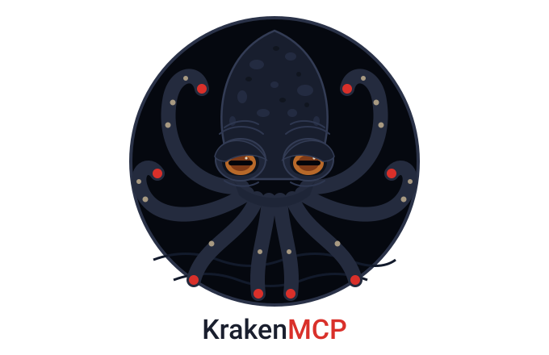

<p align="center"></p>

# KrakenMCP

**Get more out of every AI subscription you pay for.**

KrakenMCP lets your coding agent hand work off to other headless coding agents.

- **What:** an MCP server that lets your agent delegate tasks to the other coding agents on your machine.
- **Why:** save usage and context: spread the work efficiently across all your agent subscriptions, outside your chat.
- **How:** your agent coordinates the session over MCP, and Kraken runs the other agents in headless mode for each task.

You keep talking to one agent, the "head", for example OpenCode running DeepSeek Flash. When a
task needs planning, coding, a review or research, the head gives it to a "tentacle": another
agent CLI that Kraken starts with the model you chose for that job, for example Claude Code running
Opus. A strong model can plan and review while a cheap one writes the code. Only short summaries
come back, so your chat stays small. Code is written on its own git branch, and nothing reaches
your checkout until you approve the merge.

```
you <-> head: OpenCode + DeepSeek Flash
          |  MCP
          v
      KrakenMCP --> tentacle      runs headless on, for example
                    think, plan   Claude Code + Opus        (read-only)
                    review        Codex + GPT               (read-only)
                    execute       OpenCode + a cheap model  (own git branch)
                    research      Claude Code + Sonnet      (web, cites sources)
                    your own      Cursor, Aider, ...
```

## The head

The head is any coding agent on your machine that has Kraken connected as an MCP server: OpenCode,
Claude Code, Codex, Cursor or any other MCP client. It's the one you chat with; it decides what to
hand off and brings the results back to you. Use a cheap, fast model here and let the tentacles do
the heavy work. To connect one, see [Install](#install).

## Tentacles

Out of the box:

| Tentacle | Does | Runs on (default) |
|---|---|---|
| `think` | Second opinion on a hard problem: options and a recommendation | Claude Code + Opus |
| `plan` | Implementation plan, file by file | Claude Code + Opus |
| `execute` | Writes the code on its own git branch | OpenCode |
| `review` | Reviews the change: approve or request changes | Claude Code + Opus |
| `explain` | One-page map of part of the codebase | OpenCode |
| `research` | Searches the web, cites sources | Claude Code + Sonnet |

Add your own with `krakenmcp edit <name>`: it creates `~/.kraken/tentacles/<name>.md`, a short
settings header and a prompt, and the head can use it right away:

```markdown
---
description: Audit dependencies for known problems
access: read
agent: claude
model: sonnet
---
You are the AUDITOR. Check the dependencies of this repository: {{task}}
List each problem as "[severity] package - problem - fix".
```

Supported agents: [Claude Code](https://code.claude.com/docs), [OpenCode](https://opencode.ai),
[Codex](https://github.com/openai/codex) (untested), [Cursor CLI](https://cursor.com/docs/cli)
(untested), [Aider](https://aider.chat) (untested).

## Chains

A chain runs a list of tentacle stages by itself: `chain(task)`. The built-in `default` chain is
plan → execute → review. After each stage whose autonomy is `ask` the chain pauses and the head asks
you whether to go on, so on a fresh install it pauses after plan and after execute. When a review
requests changes or `verify` fails, the chain sends the work back to the agent ("fix rounds") without
pausing, up to `max_fix_rounds` (default 1; `0` turns them off).

Write your own in `~/.kraken/chains/<name>.md`:

```markdown
---
description: Plan and implement on my own, then let me look before the review
stages: [{"tentacle": "plan", "autonomy": "auto"}, {"tentacle": "execute"}, {"tentacle": "review"}]
max_fix_rounds: 2
---
```

```sh
krakenmcp chain list            # every chain, its stages and their autonomy
krakenmcp chain edit <name>     # open your file for it (created if missing), then check it
krakenmcp chain remove <name>   # delete your file; a built-in goes back to its defaults
```

## Install

You need Node.js 22.13+, git, and at least one supported agent CLI, installed and logged in.

```sh
npm install -g github:gateniomer/krakenmcp
krakenmcp doctor            # optional: check which agents Kraken finds
```

The same command installs and updates Kraken: it installs straight from GitHub and adds the
`krakenmcp` command, and running it again fetches the latest `main`. A global install can run
`krakenmcp update` instead. Restart your MCP client afterwards, since the server starts with the
client.

Then connect it to your head. For OpenCode, add this to `~/.config/opencode/opencode.json`:

```json
{ "mcp": { "kraken": { "type": "local", "command": ["krakenmcp"], "enabled": true } } }
```

For Claude Code: `claude mcp add kraken -- krakenmcp`. Other clients:
[docs/reference.md](docs/reference.md#connect-a-client).

## Use it

Just ask the head. It knows when and how to use Kraken:

```
you:   Add a dark mode toggle to the settings page.

head:  → plan("add a dark mode toggle")    runs on Claude Code + Opus
       ← a plan: theme setting, toggle, CSS variables
head:  Plan ready: theme setting, toggle, CSS variables. Execute it?

you:   Yes.

head:  → execute(plan)                     runs on OpenCode, on branch kraken/execute_7f3a
       ← done, tests pass
head:  Done: 3 files changed, tests pass. Review it?

you:   Yes.

head:  → review(run)                       runs on Claude Code + Opus
       ← approve
head:  Approved. Merge it?

you:   Yes.

head:  → merge(run)
head:  Merged into main.
```

`→` is a tool call the head makes, `←` is what comes back. Each call, each progress update and each
result also shows up as a small card:

```
╭─ 🦑 execute › opencode deepseek-v4.1-flash ────── ● running ─╮
│ run   execute_7f3a                                           │
│ time  1m 12s · $0.04 · 9 tools                               │
│ now   using edit                                             │
╰──────────────────────────────────────────────────────────────╯
```
 The head stops after each step because
every tentacle's autonomy is `ask` by default. Set `autonomy: auto` on a tentacle to let the head take
the next step by itself, or tell the head "work in auto this session".

To read what an agent wrote in full:

```sh
krakenmcp show              # the newest result (a plan, a review, research)
krakenmcp show <run_id> --log   # the agent's raw output
```

## Configure tentacles

Your tentacle files live in `~/.kraken/tentacles/`.

```sh
krakenmcp list              # every tentacle, its settings, and where each value came from
krakenmcp edit <name>       # open your file for it (created with the current values), then check it
krakenmcp remove <name>     # delete your file; a built-in goes back to its defaults
```

**Change a built-in:** write only what you want to change. For example
`~/.kraken/tentacles/execute.md`, to run your tests after every code change:

```markdown
---
verify: npm test
---
```

All fields are in [docs/reference.md](docs/reference.md#tentacle-fields-and-settings-layers).

## Autonomy

Every tentacle has `autonomy: ask | auto` (default `ask`). It decides what happens after the
tentacle finishes successfully:

- `ask`: the head shows the result, suggests one next step, and waits for you.
- `auto`: the head (or a chain) takes that step without asking.

Merging is the step after review, so the **review** tentacle's autonomy decides it. With
`autonomy: auto` in `~/.kraken/tentacles/review.md`, an approved branch merges at once, but only
when `verify` passed (a command from your files, not one the head passed in the call), nothing
conflicts and nothing is uncommitted. Anything less shows the preview and waits.

Some things always stop, whatever the autonomy: a question for you, a failed, timed-out or
over-budget run, a failed `verify`, and `discard`. "Work in auto this session" only changes how
the head behaves until you say otherwise; nothing is stored, and it never gets past these stops or
the merge checks.

## Other settings

```sh
krakenmcp limit 3           # how many runs may work at once
krakenmcp poll 25           # seconds each status check waits; longer = fewer tool calls in the chat
krakenmcp prune             # delete old logs and results
```

## Security

Code-writing agents auto-approve their own edits inside their worktree, `verify` runs shell
commands, and `merge` changes your checkout. Read [SECURITY.md](SECURITY.md) before using Kraken
on code you care about.

## More

- [docs/reference.md](docs/reference.md): every tool, field, CLI command and agent adapter
- [CONTRIBUTING.md](CONTRIBUTING.md): code layout, tests, how to add an agent
- [CHANGELOG.md](CHANGELOG.md)

```sh
npm install && npm test     # development: unit + end-to-end tests (no tokens, about 2 minutes)
```

Runs on macOS and Linux. Runs, messages and results live in a local SQLite database in
`~/.kraken`, so work survives restarts and Kraken itself sends nothing anywhere.

## License

[MIT](LICENSE)
